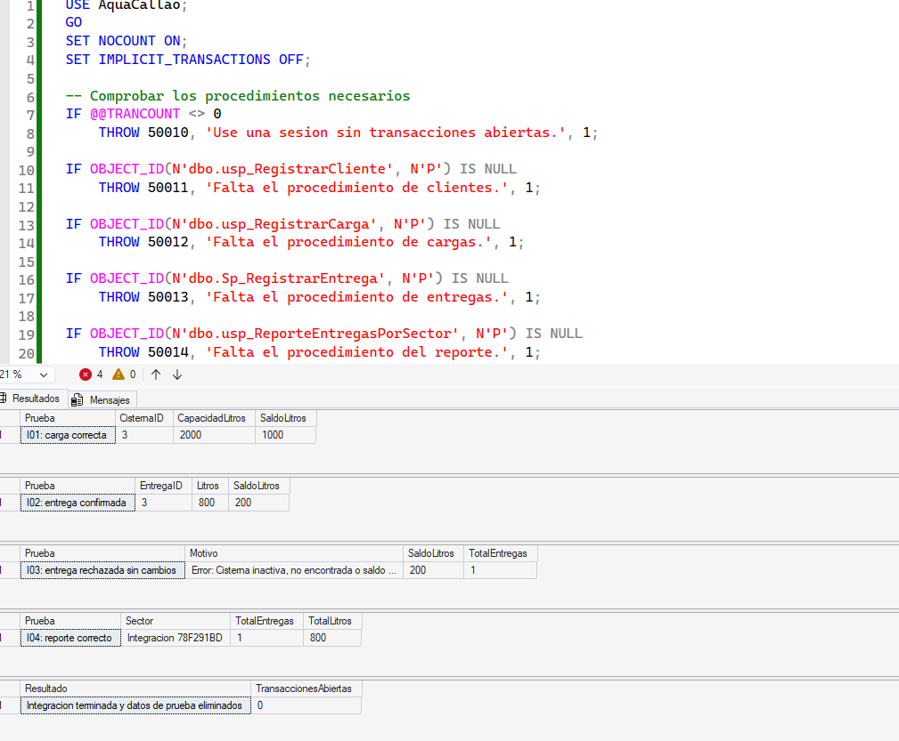

# AquaCallao — PA3
## Programación Avanzada de Base de Datos · ISIL · Grupo 02

## Integrantes y participación

| Integrante | Participación |
|---|---|
| Lucero Helen Corrales Granda | Esquema de tablas, relaciones y diccionario de campos. |
| Andy Alexandre Lescano Espino | Análisis del proceso, arquitectura cliente/servidor, registro de clientes y pruebas P1. |
| Fernando Álvaro Quispe Trigos | Registro de cargas, control de capacidad y pruebas P2. |
| Farid Alessandro Mori Barrientos | Registro transaccional de entregas y demostración de confirmación y cancelación. |
| Jorge Raúl Campoblanco Noriega | Reporte por sector, pruebas del reporte, integración y matriz de resultados. |

## 1. Descripción del problema

AquaCallao es un caso académico de distribución de agua por cisternas en sectores del Callao. Se necesita registrar beneficiarios, productos, cargas y entregas, manteniendo un saldo coherente de litros disponibles.

Una entrega requiere dos cambios: descontar litros de la cisterna y guardar el movimiento. Si solo se aplica uno, el saldo deja de corresponder con las operaciones registradas. De forma similar, una carga debe guardar el ingreso y aumentar el saldo sin exceder la capacidad.

## 2. Objetivo

Implementar una solución en Microsoft SQL Server que centralice las reglas de registro en procedimientos almacenados, utilice parámetros y proteja las operaciones de carga y entrega mediante transacciones explícitas. Comprobar los resultados con consultas, casos favorables y desfavorables, capturas y una matriz de pruebas.

El alcance comprende scripts y documentación. SSMS representa al cliente; no se requiere una aplicación web ni móvil.

## 3. Análisis y arquitectura cliente/servidor

El proceso de mantenimiento analizado es el registro de beneficiarios. El operador envía nombre, documento y sector. SQL Server valida los datos y la unicidad del documento, registra al cliente y devuelve su identificador.

- **Cliente (SSMS):** prepara las llamadas EXEC, envía parámetros y presenta los resultados o errores.
- **Servidor (SQL Server):** ejecuta los procedimientos, valida las reglas y administra los datos y transacciones.

La lógica se centraliza en el servidor para reutilizar las mismas reglas y comprobar los datos donde se almacenan. La restricción UNIQUE de Documento respalda la validación del procedimiento frente a registros duplicados.

Desarrollo del aporte de Andy:

- [Análisis del proceso y contrato cliente/servidor](docs/02_analisis_proceso_cliente_servidor.md)
- [Diagrama de arquitectura](docs/arquitectura_cliente_servidor.png)
- [Flujo del registro de clientes](docs/flujo_RegistrarCliente.png)

## 4. Modelo de datos

| Tabla | Función | Campos principales |
|---|---|---|
| Cliente | Beneficiarios y sector al que pertenecen. | ClienteID, Nombre, Documento, Sector, Activo |
| Producto | Catálogo de productos. | ProductoID, Nombre, UnidadMedida, Activo |
| Cisterna | Vehículo, capacidad y saldo disponible. | CisternaID, Placa, CapacidadLitros, SaldoLitros, Estado |
| CargaAgua | Ingresos de agua a una cisterna. | CargaID, CisternaID, ProductoID, Litros, FechaCarga |
| Entrega | Salidas de agua a beneficiarios. | EntregaID, ClienteID, CisternaID, ProductoID, Litros, FechaEntrega |

Las claves foráneas relacionan cargas y entregas con sus registros de referencia. Las restricciones CHECK exigen litros positivos en los movimientos, capacidad positiva y saldo entre cero y la capacidad. Los documentos, nombres de productos y placas tienen restricciones de unicidad.

- [Creación de tablas y datos iniciales](01_CrearTablas.sql)
- [Diccionario de campos](Diccionario%20de%20campos.pdf)
- [Prueba de inserción rechazada por clave foránea](Inserci%C3%B3n%20rechazada.sql)

La prueba de clave foránea supone que CisternaID 999 no existe y ProductoID 1 existe; estas condiciones deben comprobarse antes de ejecutarla.

## 5. Procedimientos y parámetros

| Procedimiento | Parámetros de entrada | Salida | Función |
|---|---|---|---|
| dbo.usp_RegistrarCliente | @Nombre, @Documento, @Sector | @ClienteID OUTPUT y RETURN | Registrar un beneficiario y controlar datos inválidos o documentos repetidos. |
| dbo.usp_RegistrarCarga | @CisternaID, @ProductoID, @Litros | Sin parámetro OUTPUT | Registrar una carga y aumentar el saldo respetando la capacidad. |
| dbo.Sp_RegistrarEntrega | @ClienteID, @CisternaID, @ProductoID, @Litros | @EntregaID OUTPUT | Descontar saldo y registrar una entrega en una transacción. |
| dbo.usp_ReporteEntregasPorSector | @Sector | Conjunto de resultados | Devolver cantidad de entregas y total de litros del sector. |

### Clientes

Se eliminan espacios de los parámetros. Nombre y sector son obligatorios; el documento debe contener entre 8 y 12 dígitos. El procedimiento comprueba duplicados y la tabla dispone de una restricción UNIQUE.

OUTPUT devuelve el identificador generado; RETURN informa el estado: 0 para registro correcto, 1 para datos inválidos y 2 para documento duplicado. Son respuestas con funciones diferentes.

### Cargas

El procedimiento comprueba cisterna existente y operativa, producto activo y capacidad disponible. Lee la cisterna con UPDLOCK para coordinar operaciones que modifican su saldo. El registro de carga y el aumento del saldo se realizan en la misma transacción.

### Entregas

La actualización exige una cisterna operativa con saldo suficiente. Si ninguna fila cumple la condición, se genera un error. Si el descuento y el registro de la entrega terminan correctamente, se confirma la transacción; ante un error, se revierte.

Las claves foráneas comprueban la existencia de cliente y producto. La versión actualmente publicada todavía no comprueba su estado Activo en este procedimiento. La validación explícita de litros nulos y la inicialización de @EntregaID a NULL también quedan pendientes de ajuste. Estas condiciones no forman parte de los casos aprobados de la matriz actual.

### Reporte por sector

El parámetro @Sector se limpia con LTRIM/RTRIM y se rechaza cuando está vacío o es NULL. El reporte relaciona Cliente con Entrega, cuenta las entregas y suma los litros utilizando BIGINT. Si el sector no tiene entregas, devuelve una fila con ambos totales en cero.

## 6. Transacciones y consistencia

| Comportamiento | Inicio y finalización | Aplicación al caso |
|---|---|---|
| Autoconfirmación | Fuera de una transacción abierta, cada sentencia se confirma individualmente si termina correctamente. | Un INSERT y un UPDATE separados podrían dejar cambios parciales si el segundo falla. |
| Implícito | Con SET IMPLICIT_TRANSACTIONS ON, determinadas sentencias inician una transacción cuando no hay otra abierta; se necesita COMMIT o ROLLBACK para terminarla. | Exige controlar el cierre para evitar cambios pendientes y bloqueos prolongados. |
| Explícito | BEGIN TRANSACTION inicia la unidad de trabajo; COMMIT confirma y ROLLBACK cancela. | Se utiliza dentro de los procedimientos de carga y entrega para agrupar ambos cambios. |

En una carga se confirma cuando el movimiento y el incremento de saldo terminan correctamente. En una entrega se confirma cuando el descuento y el movimiento quedan registrados. Un error dentro del bloque TRY conduce al CATCH, que cancela la transacción activa y comunica el fallo.

La condición de saldo se evalúa en el UPDATE del servidor. Esto evita separar la comprobación del descuento en dos llamadas del cliente.

Para las cisternas creadas con saldo cero, la conciliación esperada es:

**SaldoLitros = litros cargados − litros entregados.**

La integración se ejecuta sin una transacción externa alrededor de las llamadas, porque los procedimientos publicados realizan un ROLLBACK completo ante errores. Al finalizar, elimina sus datos exclusivos y comprueba que no queden transacciones abiertas.

## 7. Requisitos y orden de ejecución

Se requiere Microsoft SQL Server, SSMS y permisos para crear la base de datos y sus objetos. Las evidencias de clientes indican SQL Server 2025 y SSMS 22.

Ejecutar en una base de pruebas. No volver a ejecutar la creación de base y tablas si AquaCallao ya existe.

### Primera ejecución sobre una base nueva

| Orden | Archivo | Indicación |
|---|---|---|
| 1 | [01_CrearTablas.sql](01_CrearTablas.sql) | Crear AquaCallao, tablas, restricciones y datos iniciales. |
| 2 | [sql/02_RegistrarCliente.sql](sql/02_RegistrarCliente.sql) | Crear el procedimiento y ejecutar P1. El script de prueba supone una base recién inicializada. |
| 3 | [sql/03_RegistrarCarga.sql](sql/03_RegistrarCarga.sql) | Crear el procedimiento y ejecutar P2; sobre el estado inicial deja la cisterna 1 con 1000 litros. |
| 4 | [sql/04_RegistrarEntrega.sql](sql/04_RegistrarEntrega.sql) | Crear dbo.Sp_RegistrarEntrega. |
| 5 | [sql/04_DemostracionEntregas.sql](sql/04_DemostracionEntregas.sql) | Ejecutar P3 y P4 después de P2: entrega 300 litros y rechaza 800 cuando quedan 700. |
| 6 | [06_reporte_sector.sql](06_reporte_sector.sql) | Crear el reporte por sector. |
| 7 | [pruebas_reportes/07_pruebas_reporte.sql](pruebas_reportes/07_pruebas_reporte.sql) | Ejecutar R01–R04 con datos exclusivos que se revierten. |
| 8 | [pruebas_reportes/08_pruebas_integracion.sql](pruebas_reportes/08_pruebas_integracion.sql) | Ejecutar I01–I04; crea datos exclusivos y los elimina al finalizar. |

Para instalar los procedimientos sobre una base ya existente sin repetir P1 y P2, ejecutar solamente sus bloques de definición hasta el GO anterior a las pruebas. Después crear el procedimiento de entregas y el reporte, y ejecutar los scripts 07 y 08.

P1, P2 y la demostración de entregas dependen del estado de los datos y no deben repetirse suponiendo siempre los mismos saldos, cantidades o IDs. Los IDs de las capturas corresponden a una ejecución concreta.

Los errores de duplicado, entrada inválida o saldo insuficiente son esperados solo en sus respectivos casos de rechazo. Deben interpretarse junto con el estado posterior de las tablas; un mensaje de error aislado no demuestra por sí solo que la prueba haya sido correcta.

## 8. Pruebas y evidencias

| Grupo | Casos y resultados | Soporte |
|---|---|---|
| P1 — Clientes | Alta válida; rechazo de documento duplicado y de documento con letras. | [Matriz e interpretación](evidencias/P1_alta_cliente.md) |
| P2 — Cargas | El script plantea cargar 1000 litros y rechazar otros 1100 en una cisterna de capacidad 2000. | [Script de carga y prueba](sql/03_RegistrarCarga.sql). Pendiente adjuntar evidencia específica de exceso de capacidad. |
| P3/P4 — Entregas | El script plantea entregar 300 litros y rechazar 800 después de P2. | [Demostración](sql/04_DemostracionEntregas.sql). La integración aporta evidencia adicional de confirmación y rechazo con otras cantidades. |
| R01–R04 — Reporte | Dos entregas por 800 litros; sector sin entregas; rechazo de sector vacío y nulo. | [Script](pruebas_reportes/07_pruebas_reporte.sql), [ejecución](pruebas_reportes/01_ejecuci%C3%B3n.png) y [resultados](pruebas_reportes/02_resultado.png). |
| I01–I04 — Integración | Carga de 1000 litros, entrega de 800, rechazo de 300 con saldo 200 y reporte de una entrega por 800 litros. | [Matriz](pruebas_reportes/matriz_pruebas.md) y [captura](pruebas_reportes/03_resultados_integracion.png). |

### Resultados de integración

La ejecución documentada mostró saldo de 1000 litros después de la carga y 200 después de la entrega de 800. El intento posterior de entregar 300 fue rechazado: el saldo permaneció en 200 y se mantuvo una sola entrega. El reporte devolvió una entrega y 800 litros.

El script terminó con el mensaje de limpieza de los datos de prueba y TransaccionesAbiertas = 0.

### Evidencias de clientes

- [Estado antes y después](evidencias/P1_resultados_antes_despues.png)
- [Mensajes de rechazo](evidencias/P1_mensajes_error.png)

Las evidencias respaldan los escenarios descritos; no se presentan como pruebas de todas las entradas posibles ni de concurrencia entre sesiones.

## 9. Relación con los contenidos del curso

- Arquitectura cliente/servidor: separación entre envío de parámetros y ejecución de reglas.
- Procedimientos almacenados: mantenimiento de clientes y operaciones reutilizables.
- Parametrización: entradas, OUTPUT y valores de retorno.
- Transacciones: confirmación o cancelación de operaciones relacionadas.
- Manejo de errores: TRY/CATCH, RAISERROR y THROW.
- Pruebas comparativas: revisión de saldos y movimientos antes y después de cada operación.

## 10. Conclusiones

1. Los procedimientos permiten centralizar las reglas y recibir parámetros sin repetir la lógica en el cliente.
2. OUTPUT y RETURN cumplen funciones distintas: devolver datos y comunicar estados.
3. Agrupar el movimiento y la modificación del saldo en una transacción evita conservar cambios parciales ante errores.
4. La integración documentada relacionó clientes, cargas, entregas y reporte, y comprobó que el rechazo por saldo insuficiente mantuviera los datos esperados.
5. Comparar el saldo, los movimientos y el reporte permite sustentar la consistencia con resultados observables.

## 12. Video de exposición

**Video público de YouTube: [PENDIENTE DE INCORPORAR EL ENLACE]**

