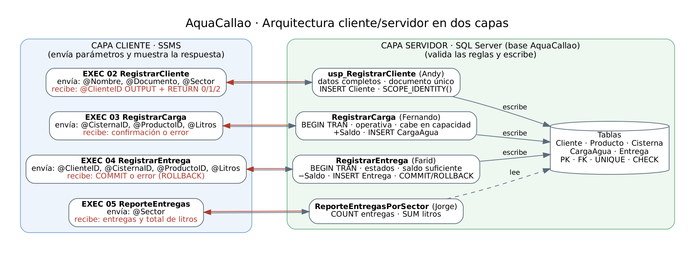
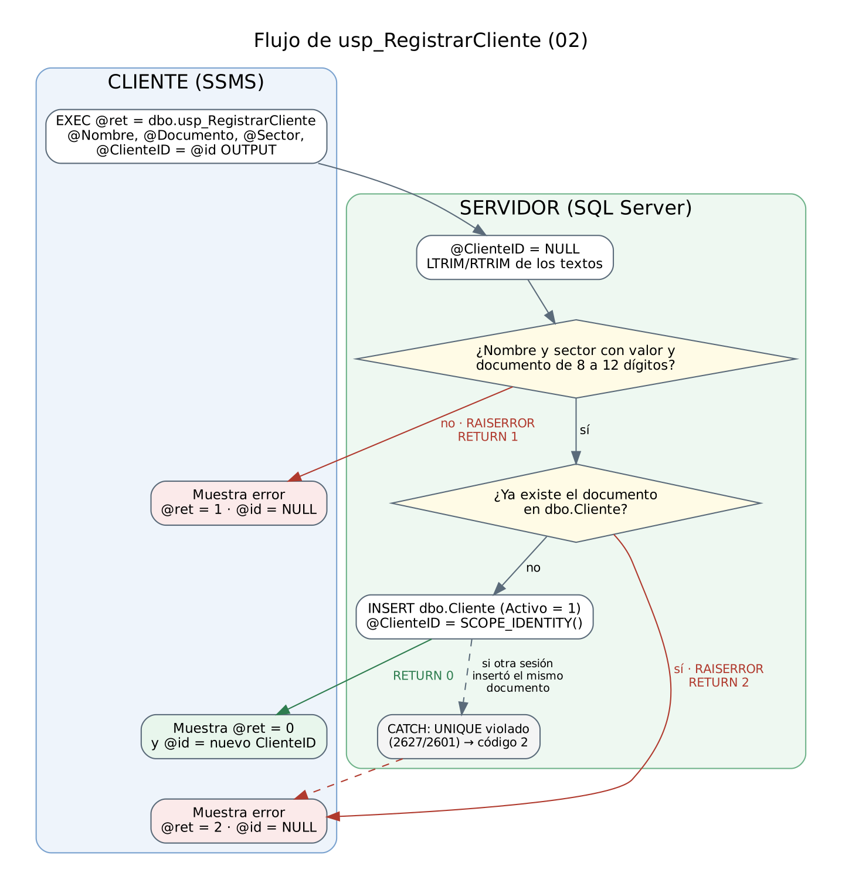

# Análisis del proceso y arquitectura cliente/servidor

**Autor:** Andy Alexandre Lescano Espino · **Script:** `sql/02_RegistrarCliente.sql` · **Sesión 9**

## 1. Proceso que se automatiza

El operador de AquaCallao registra beneficiarios antes de entregarles agua. La operación se repite muchas veces y tiene reglas que no pueden depender de que el operador "lo haga bien": el documento no puede repetirse y los datos deben estar completos. Por eso el alta se implementa como el procedimiento almacenado `dbo.usp_RegistrarCliente`. El cliente solo envía datos, y el servidor decide si se registra o no.

| | Detalle |
|---|---|
| **Entradas** | `@Nombre nvarchar(100)`, `@Documento varchar(20)`, `@Sector nvarchar(60)` |
| **Salida** | `@ClienteID int OUTPUT`: el ID del cliente creado; es `NULL` si no se creó |
| **Valor de retorno** | `0` registrado · `1` datos inválidos · `2` documento ya registrado |
| **Regla 1** | Nombre y sector no pueden estar vacíos. El documento debe tener solo dígitos, entre 8 y 12, y se guarda como texto para conservar los ceros iniciales. |
| **Regla 2** | El documento es único. Se valida antes del INSERT y, como respaldo, con la restricción `UQ_Cliente_Documento`. |
| **Efecto** | Inserta una fila en `dbo.Cliente` con `Activo = 1`. Si falla una regla, no inserta nada. |

`@Documento` se declara de 20 caracteres, más grande que la columna de 12, a propósito. Si el parámetro fuera de 12, SQL Server cortaría en silencio un documento más largo y podría registrar uno equivocado o chocar con otro existente. Con 20 caracteres el procedimiento recibe el valor completo y lo rechaza.

## 2. Arquitectura en dos capas



- **Capa cliente (SSMS):** representa la aplicación del operador. Solo arma la llamada `EXEC` con parámetros y muestra lo que recibe: el ID, el código de retorno, el mensaje de error o las filas del reporte.
- **Capa servidor (SQL Server):** contiene los procedimientos de los cuatro integrantes. Valida todas las reglas, escribe en las tablas y, en las operaciones de saldo, controla la transacción.

## 3. Flujo del procedimiento 02



## 4. Contrato cliente/servidor

Ejemplo de llamada desde el cliente:

```sql
DECLARE @id int, @ret int;
EXEC @ret = dbo.usp_RegistrarCliente
     @Nombre    = N'Beneficiario Mi Peru 01',
     @Documento = '04567890',
     @Sector    = N'Mi Perú',
     @ClienteID = @id OUTPUT;
SELECT @ret AS CodigoRetorno, @id AS ClienteID_Devuelto;   -- 0 y 2
```

**OUTPUT y RETURN no son lo mismo:**

| | `@ClienteID OUTPUT` | `RETURN` |
|---|---|---|
| Qué devuelve | Un **dato**: el identificador generado por `SCOPE_IDENTITY()` | Un **estado**: cómo terminó la operación |
| Tipo | El que se declare; aquí `int` | Siempre un `int` |
| Cuántos | Puede haber varios parámetros OUTPUT | Uno solo |
| Cómo se recibe | `@ClienteID = @id OUTPUT`, sin olvidar la palabra OUTPUT | `EXEC @ret = procedimiento` |
| Si falla | `NULL`; el cliente nunca recibe un ID falso | `1` o `2`, según la regla que no se cumplió |

Se usan los dos porque responden preguntas diferentes. El código de retorno le dice al cliente si la operación salió bien, y el ID le dice qué cliente se creó. Usar el RETURN para devolver el ID mezclaría ambas cosas: un `2` podría ser el cliente 2 o el código "documento repetido".

## 5. Por qué la lógica va en el servidor

- **Una sola regla para todos:** cualquier aplicación que registre clientes pasa por el mismo procedimiento, así que la validación no depende de cada programa cliente.
- **Los datos se validan donde están:** solo el servidor conoce el estado real de las tablas en el momento de escribir. El cliente podría estar viendo datos desactualizados.
- **Doble protección:** el procedimiento informa un error claro y, si dos sesiones intentan el mismo documento a la vez, la restricción UNIQUE impide el duplicado igual.

**Por qué el saldo de la cisterna se valida en el servidor** (procedimientos 03 y 04):

- Si el cliente leyera el saldo, decidiera y luego enviara la actualización, otro operador podría descontar litros en el medio y el saldo quedaría negativo o mayor que la capacidad.
- En el servidor, la condición se evalúa en la misma sentencia que modifica el saldo, dentro de una transacción explícita (`UPDATE ... WHERE SaldoLitros >= @Litros AND Estado = 'Operativa'`). Si ninguna fila cumple, se cancela todo con ROLLBACK.
- Así se cumple la regla de conciliación del caso: **saldo = litros cargados − litros entregados**.
