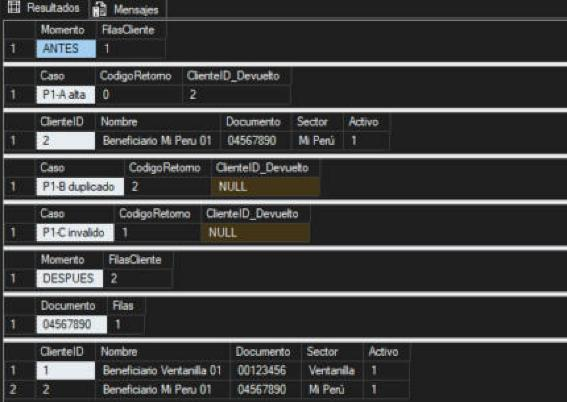
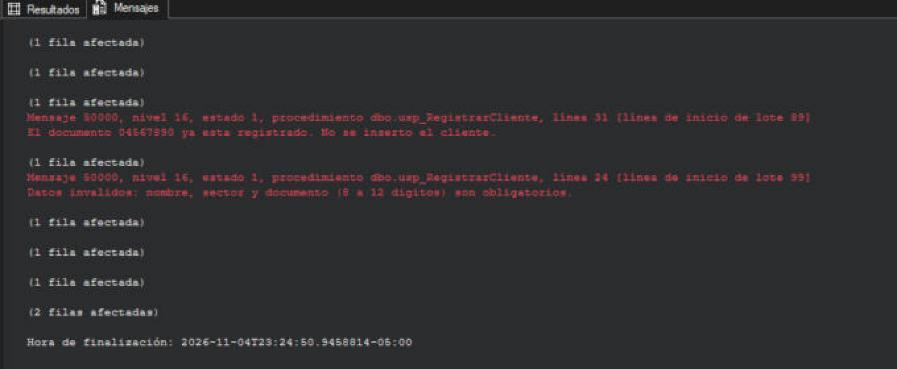

# P1 · Alta de cliente — Andy Lescano

**Script:** `sql/02_RegistrarCliente.sql` · **Base:** AquaCallao recién inicializada con `01_CrearTablas.sql` · **Ejecución:** SQL Server 2025 (17.0), SSMS 22, 04/11/2026

## Matriz de pruebas

| Caso | Acción | Estado inicial | Resultado esperado | Resultado observado | ¿Cumple? |
|---|---|---|---|---|---|
| P1-A | Registrar `Beneficiario Mi Peru 01`, documento `04567890`, sector **Mi Perú** | 1 cliente (Ventanilla) | RETURN 0, se devuelve un ID y aparece una fila | RETURN **0**, ClienteID **2**, fila creada con `Activo = 1` | ✅ |
| P1-B | Repetir el documento `04567890` | 2 clientes | Error informado y una sola fila con ese documento | Mensaje 50000: *"El documento 04567890 ya esta registrado"*; RETURN **2**, ID **NULL**; sigue **1** fila con ese documento | ✅ |
| P1-C (extra) | Documento con letras `ABC12345` | 2 clientes | Error de datos inválidos y ninguna fila nueva | Mensaje 50000: *"Datos invalidos..."*; RETURN **1**, ID **NULL** | ✅ |
| Final | Contar clientes | — | 2 clientes; el documento `04567890` aparece una vez | **2** clientes; `04567890` → **1** fila | ✅ |

## Evidencias

Resultados (estado antes, cada caso y estado después):

Mensajes de error que recibe el cliente:

## Interpretación

- **Desenlace favorable (P1-A):** el servidor validó los datos, insertó la fila y devolvió el ID por OUTPUT con el código 0. El cliente no calcula el ID; lo recibe del servidor.
- **Desenlace no favorable (P1-B y P1-C):** el servidor detectó la regla incumplida antes de escribir. Devolvió un mensaje claro, un código distinto de 0 y el ID en NULL. La tabla quedó igual que antes, con un solo registro por documento.
- **Conclusión:** el procedimiento protege la consistencia de `Cliente` sin depender de la aplicación cliente. El código de retorno permite al cliente reaccionar según el motivo del rechazo.
