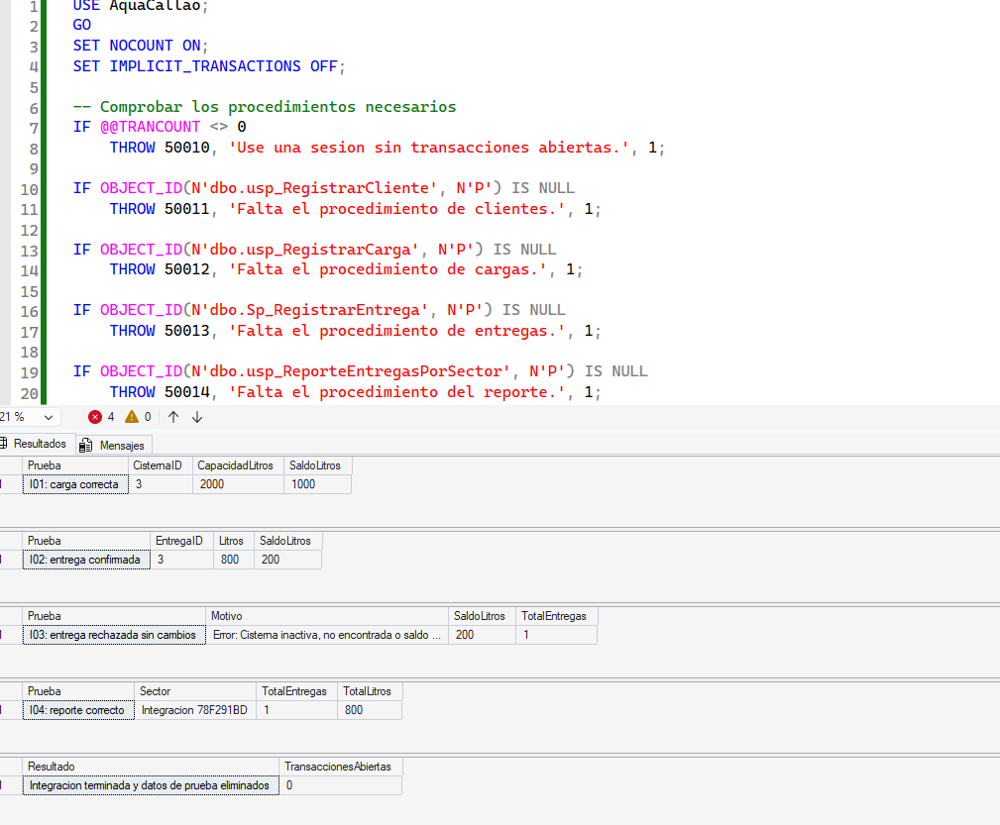

# Matriz de pruebas de integración

Responsable: Jorge Raúl Campoblanco Noriega  
Base de datos: AquaCallao  
Script: 08_pruebas_integracion.sql

Se comprueba la integración del registro de clientes, cargas,
entregas y reporte por sector mediante datos exclusivos de prueba.

| Caso | Operación | Resultado esperado | Resultado observado | Estado |
|---|---|---|---|---|
| I01 | Cargar 1000 litros en una cisterna con saldo inicial 0 y capacidad de 2000 litros. | Carga registrada y saldo de 1000 litros. | El script verificó la carga y mostró saldo de 1000 litros. | Correcto |
| I02 | Registrar una entrega de 800 litros. | Entrega registrada y saldo de 200 litros. | EntregaID 3, entrega de 800 litros y saldo de 200 litros. | Correcto |
| I03 | Intentar entregar 300 litros cuando quedan 200. | Rechazar la operación sin cambiar el saldo ni registrar otra entrega. | Se recibió el error de saldo insuficiente; permanecieron 200 litros y una entrega. | Correcto |
| I04 | Consultar el reporte del sector de prueba. | Una entrega y un total de 800 litros. | El reporte devolvió una entrega y 800 litros. | Correcto |
| Cierre | Eliminar los datos utilizados y comprobar las transacciones. | Datos de prueba eliminados y ninguna transacción abierta. | El script confirmó la limpieza y mostró TransaccionesAbiertas = 0. | Correcto |

## Evidencia

## Interpretación

La entrega válida registró el movimiento y descontó el saldo.
El intento de entregar más agua de la disponible fue rechazado
sin modificar el saldo ni la cantidad de entregas. El reporte
coincidió con la entrega confirmada.

Los datos creados para esta ejecución se eliminaron al finalizar.
Estas pruebas comprueban los escenarios descritos; no incluyen
pruebas de concurrencia ni todas las entradas inválidas posibles.

## Pruebas individuales del reporte

El archivo 07_pruebas_reporte.sql contiene las pruebas del sector
con entregas, sector sin entregas, sector vacío y sector nulo.

Evidencias:
- [Ejecución del reporte](01_ejecución.png)
- [Resultados del reporte](02_resultado.png)
